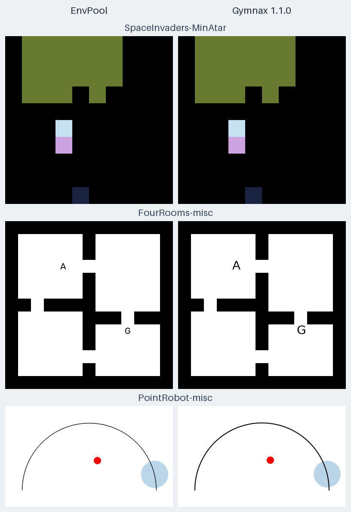

Gymnax
======

EnvPool adds 20 native tasks from
`Gymnax 1.1.0 <https://github.com/RobertTLange/gymnax/tree/b88dd87ca3917f1723d14016f0b1c9719e893d77>`_
that run in C++ on the CPU. Use ``Gymnax/<task ID>`` or the short
task ID with the Gymnasium or ``dm_env`` API. Seven other tasks use
existing EnvPool IDs.

Try Space Invaders
------------------

The first agent fires and the second moves left. The observation has
six binary channels per cell. The renderer combines the channels into
one color per cell.

.. code-block:: python

    import envpool
    import numpy as np

    pool = envpool.make_gymnasium(
        "Gymnax/SpaceInvaders-MinAtar",
        num_envs=2, seed=7, render_mode="rgb_array",
    )
    obs, info = pool.reset()
    obs, rewards, terminated, truncated, info = pool.step(
        np.array([3, 1], dtype=np.int32)
    )
    frames = pool.render(env_ids=[0, 1])
    pool.close()

Each pair shows the same state after several actions, with EnvPool on
the left and Gymnax on the right. In the maze, A marks the agent and G
the goal. In the bottom row, the red point earns a reward inside the
blue disk.

Available tasks
---------------

Shapes exclude the batch dimension. Actions are numbered from zero.
1D and 2D denote continuous controls with one or two components.
The limit is the default ``max_episode_steps``. A task can terminate
earlier. RGB indicates support for ``rgb_array`` and ``human`` rendering.

============================  ================  ========  ======  ===
ID after ``Gymnax/``          Observation       Actions   Limit   RGB
============================  ================  ========  ======  ===
``Asterix-MinAtar``           ``(10, 10, 4)``   5         1000    Yes
``Breakout-MinAtar``          ``(10, 10, 4)``   3         1000    Yes
``Freeway-MinAtar``           ``(10, 10, 7)``   3         2500    Yes
``Seaquest-MinAtar``          ``(10, 10, 10)``  6         1000    Yes
``SpaceInvaders-MinAtar``     ``(10, 10, 6)``   4         1000    Yes
``DeepSea-bsuite``            ``(8, 8)``        2         8       —
``DiscountingChain-bsuite``   ``(2,)``          5         100     —
``MemoryChain-bsuite``        ``(3,)``          2         1000    —
``MNISTBandit-bsuite``        ``(28, 28)``      10        1       —
``SimpleBandit-bsuite``       ``(1, 1)``        11        100     —
``UmbrellaChain-bsuite``      ``(3,)``          2         100     —
``BernoulliBandit-misc``      ``(4,)``          2         100     —
``FourRooms-misc``            ``(4,)``          4         500     Yes
``GaussianBandit-misc``       ``(4,)``          2         100     —
``MetaMaze-misc``             ``(15,)``         4         200     Yes
``PointRobot-misc``           ``(6,)``          2D        100     Yes
``Pong-misc``                 ``(30, 40, 3)``   3         1000    Yes
``Reacher-misc``              ``(8,)``          2D        100     —
``Snake-misc``                ``(10, 10, 3)``   4         1000    —
``Swimmer-misc``              ``(16,)``         2D        500     —
============================  ================  ========  ======  ===

Tasks with existing EnvPool IDs
-------------------------------

Use ``CartPole-v1``, ``Acrobot-v1``, ``Pendulum-v1``, ``MountainCar-v0``
and ``MountainCarContinuous-v0`` directly. For Gymnax's continuous
mountain car dynamics, pass ``stop_at_left_wall=False`` to keep the
negative velocity on hitting the wall. See :doc:`classic_control`.

For ``Catch-bsuite``, use ``Catch-v0``. For ``FrozenLake-misc``, use
``FrozenLake-v1`` on the 4 by 4 map or ``FrozenLake8x8-v1`` on the
8 by 8 map. See :doc:`toy_text`.

Actions and observations
------------------------

MinAtar uses the smallest action set for each game by default. The
following actions are listed in order starting at zero.

* ``Asterix`` uses stay, left, up, right, down.
* ``Breakout`` uses stay, left, right.
* ``Freeway`` uses stay, up, down.
* ``Seaquest`` uses stay, left, up, right, down, fire.
* ``SpaceInvaders`` uses stay, left, right, fire.

Pass ``use_minimal_action_set=False`` to use all six actions in
``Seaquest`` order in any MinAtar game. In ``Pong`` the actions are
stay, up, down. The channels encode objects and their movement trails.

``FourRooms``, ``MetaMaze`` and ``Snake`` use up, right, down, left.
``Snake`` accepts ``height`` and ``width``. Its channels show the
body, head and apple. ``info["length"]`` includes the head.

Observations are ``float32`` except for the ``int32`` agent and goal
coordinates in ``FourRooms``.
Space bounds include negative memory cues, signed image pixels, Gaussian
rewards and the reward of 10 in ``MetaMaze``.

Episode and task behavior
-------------------------

The last step returns the **final observation**. On the next step,
EnvPool resets that slot, ignores its action and returns the initial
observation with zero reward. Gymnax's JAX API resets on the final step
and puts the final observation in ``info["final_observation"]``.
Task termination and time limits are independent. Both flags can be
true. The ``dm_env`` discount is zero on termination and one on a
timeout alone.

* ``DeepSea`` uses the fixed action mapping from the pinned version.
  In ``MemoryChain`` each step gives the observation from before the
  action. Recall the initial cue on the sixth action.
* ``PointRobot`` checks for a reward at the position before the move.
  On success it samples a new position and keeps the goal.
* ``MNISTBandit`` samples from all 60,000 training images. Gymnax reads
  the pixels as signed bytes and divides them by 255. Predicting the
  digit pays 1 for a match and −1 otherwise. The final observation is
  all zeros. The wheel includes the two original compressed training
  files (about 10 MB) for offline use. See ``envpool/gymnax/NOTICE``
  for attribution.

Validation
----------

Tests use the pinned JAX implementation to check each transition through
the end of an episode. The oracle starts from the sampled native pose,
goal, image, cue, layout or bandit parameters. For stochastic steps it
receives sampled moves, spawns, relocation candidates or reward noise.
Gymnax decides when to use them and computes the next state, observation,
reward and end flags. Separate tests check the draws, their distributions
and their independence across seeds, consecutive resets and parallel
slots. Each slot uses EnvPool's native random number generator.

Continuous control tasks use absolute and relative tolerances of
``2e-5`` and ``1e-5`` to account for rounding during single-precision
integration over a full episode. For all nine tasks with RGB rendering,
tests compare selected frames against the same scene in Gymnax, allowing
for font and edge differences while checking the positions of objects.
