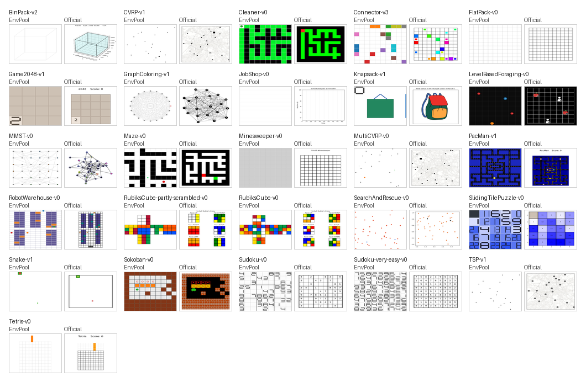

Jumanji
========

EnvPool provides native C++ batched implementations for the public task IDs in
``jumanji==1.1.2``.

``SearchAndRescue-v0`` returns the sum of the searchers' rewards as its scalar
cooperative reward. Individual rewards are available in
``info["searcher_rewards"]`` with shape ``(num_envs, 2)``.

Alignment tests initialize both implementations with the same reset state, then
run complete episodes using identical external actions. No future observations,
rewards or frames are injected into native stepping. Discrete outputs, active
EMS ordering and termination flags are checked exactly; floating-point outputs
use small numerical budgets. Inactive EMS coordinates are upstream scratch
storage and are excluded from comparison while their masks remain checked.
Search-and-rescue ray distances allow an absolute error of ``5e-5`` after
400 steps of stochastic motion; visible-event masks remain exact.
SearchAndRescue uses native Gaussian acceleration. Tests independently check
its velocity distribution and speed limit, copy actual native reset state and
target velocities into the oracle, and then compare movement, visibility,
detection, rewards and termination. Matching the oracle's random stream is
unnecessary.

``Game2048``, ``Snake`` and ``Tetris`` also use native sampling. Alignment checks validate
the sampled cell, fruit position or piece before supplying it to the official
transition; reset distributions are checked separately. PacMan exposes the
selected directions in ``info["ghost_actions"]`` with shape ``(num_envs, 4)``.
The oracle checks these against its movement policy before applying movement
and collision rules. MMST checks each move against all six possible agent
priority orders, with a separate native test for fair tie breaking.

Rendering runs in C++ and reads each environment's current state for both
synchronous and asynchronous APIs. BinPack shows normalized box outlines;
JobShop displays the complete schedule as a timeline.
The native views use simple task graphics and do not reproduce Matplotlib's
fonts, shading, layout or decorative artwork. Tests check native determinism,
frame shape/dtype, scene-content regressions and reordered asynchronous frame
selection. The comparisons below provide the official visual reference.

Render Compare
--------------

Representative reset-frame renders for all Jumanji tasks. Each panel shows
EnvPool ``env.render()`` on the left and the pinned official
``jumanji==1.1.2`` Matplotlib renderer on the right. The generation script
resets the official oracle first, passes the supported reset-state fields into
EnvPool, and writes the side-by-side comparison image from those synchronized
reset states.

Options
-------

* ``task_id (str)``: see available tasks below;
* ``num_envs (int)``: how many environments you would like to create;
* ``batch_size (int)``: the expected batch size for return result, default to
  ``num_envs``;
* ``num_threads (int)``: the maximum thread number for executing the actual
  ``env.step``, default to ``batch_size``;
* ``seed (int | Sequence[int])``: the environment seed. When a sequence is
  provided, it must contain exactly one seed per environment. Default to
  ``42``;
* ``max_episode_steps (int)``: the maximum number of steps for one episode.

Supported Tasks
---------------

* ``BinPack-v2``
* ``CVRP-v1``
* ``Cleaner-v0``
* ``Connector-v3`` (``Connector-v2`` remains as a compatibility alias)
* ``FlatPack-v0``
* ``Game2048-v1``
* ``GraphColoring-v1``
* ``JobShop-v0``
* ``Knapsack-v1``
* ``LevelBasedForaging-v0``
* ``MMST-v0``
* ``Maze-v0``
* ``Minesweeper-v0``
* ``MultiCVRP-v0``
* ``PacMan-v1``
* ``RobotWarehouse-v0``
* ``RubiksCube-partly-scrambled-v0``
* ``RubiksCube-v0``
* ``SearchAndRescue-v0``
* ``SlidingTilePuzzle-v0``
* ``Snake-v1``
* ``Sokoban-v0``
* ``Sudoku-v0``
* ``Sudoku-very-easy-v0``
* ``TSP-v1``
* ``Tetris-v0``

Example
-------

.. code-block:: python

   import envpool

   env = envpool.make_gymnasium("Sokoban-v0", num_envs=8, seed=0)
   obs, info = env.reset()
