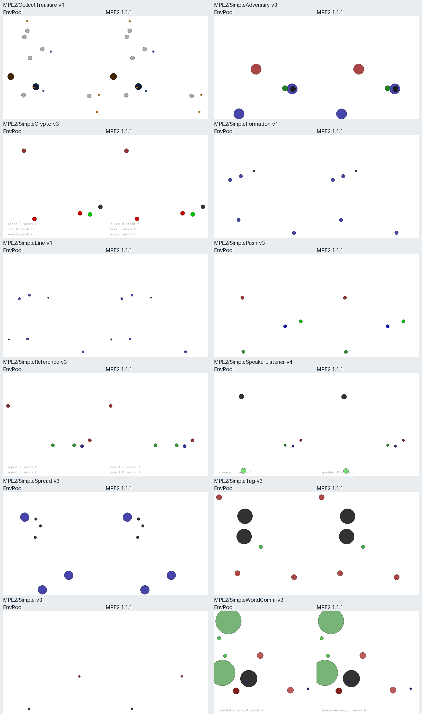

MPE2
====

EnvPool implements all twelve scenarios from `Farama MPE2 v1.1.1
<https://github.com/Farama-Foundation/MPE2/tree/v1.1.1>`_ in C++.
This includes simulation, communication, randomization, assignment, and RGB
rendering. The official Python package is used only for tests and documentation.

Each pair shows EnvPool on the left and MPE2 on the right after identical
actions. Initial state is synchronized once after reset for this comparison.

Available tasks
---------------

The observation lengths below are the original lengths in upstream agent
order. EnvPool pads shorter observations to the longest length in the scenario.
Both discrete and continuous actions are supported for every task.

.. list-table:: Default task populations and observation lengths
   :header-rows: 1
   :widths: 48 12 40

   * - Task ID
     - Players
     - Observation lengths
   * - ``MPE2/CollectTreasure-v1``
     - 8
     - 86 for collectors; 84 for deposits
   * - ``MPE2/SimpleAdversary-v3``
     - 3
     - 8 for adversary; 10 for other agents
   * - ``MPE2/SimpleCrypto-v3``
     - 3
     - 4 for Eve; 8 for Bob and Alice
   * - ``MPE2/SimpleFormation-v1``
     - 4
     - 6
   * - ``MPE2/SimpleLine-v1``
     - 4
     - 8
   * - ``MPE2/SimplePush-v3``
     - 2
     - 8 for adversary; 19 for agent
   * - ``MPE2/SimpleReference-v3``
     - 2
     - 21
   * - ``MPE2/SimpleSpeakerListener-v4``
     - 2
     - 3 for speaker; 11 for listener
   * - ``MPE2/SimpleSpread-v3``
     - 3
     - 18
   * - ``MPE2/SimpleTag-v3``
     - 4
     - 16 for adversaries; 14 for agent
   * - ``MPE2/Simple-v3``
     - 1
     - 4
   * - ``MPE2/SimpleWorldComm-v3``
     - 6
     - 34 for adversaries; 28 for agents

Every upstream module name is also registered as an alias, for example
``mpe2/simple_spread_v3`` and ``mpe2/collect_treasure_v1``. The registry is
generated from the pinned upstream source.

Options
-------

* ``num_envs``, ``batch_size``, ``num_threads``, and ``seed`` use the normal
  EnvPool meanings. A seed sequence can specify one seed per environment.
* ``max_episode_steps`` defaults to 25, corresponding to upstream
  ``max_cycles``. One step advances every player simultaneously.
* ``continuous_actions=False`` selects discrete actions; ``True`` selects
  float32 vectors in ``[0, 1]``.
* ``N`` changes the population in Adversary, Spread, Formation, and Line.
  The default is taken from the selected upstream scenario.
* ``num_good``, ``num_adversaries``, and ``num_obstacles`` configure Tag and
  World Comm. World Comm also supports ``num_food`` and ``num_forests``.
* ``num_collectors``, ``num_deposits``, and ``num_treasures`` configure Collect
  Treasure. There may be one to six deposit types.
* ``num_agent_neighbors`` and ``num_landmark_neighbors`` configure partial
  observations in Adversary, Spread, and Tag. ``-1`` means all; positive
  counts select nearest neighbors and pad missing neighbors with zeros.
* ``local_ratio=0.5`` blends local and global rewards in Reference and Spread.
* ``terminate_on_success=False`` enables early completion in Spread,
  Formation, Line, and Tag when set to ``True``. Tag succeeds when every prey
  is simultaneously touching an adversary.
* ``curriculum=False`` enables the initial curriculum stage in Spread and
  Tag. MPE2 1.1.1's inherited stage setter is a no-op, so its stage remains
  zero even after calling the upstream stage-advancement methods.
* ``benchmark_data=False`` enables the scenario's benchmark values.
* ``dynamic_rescaling=True`` scales entity radii as the world bounds change.
  The camera follows the current bounds in both modes, matching MPE2 1.1.1.
  Rendering defaults to 700 by 700 RGB pixels; ``render_width`` and
  ``render_height`` select other canvas sizes and scale the geometry.
* ``max_num_players`` is resolved from the scenario's population at
  construction. A supplied capacity must fit the population.

Player API
----------

Observations and rewards have a leading player dimension. Termination and
truncation have a leading environment dimension because every player in an
MPE2 world finishes together. A time limit takes precedence over success on
the final step, matching the upstream API.

``info["players"]`` contains ``env_id``, ``id``, ``obs_size``, ``action_size``,
and ``action_mask``. The action size is the number of legal choices
in discrete mode and the original vector length in continuous mode. Continuous
actions use zero padding for roles with fewer controls. The mask identifies
legal choices in discrete mode and valid control dimensions in continuous mode.

Movement controls are no-op, left, right, down, up. A communicating movable
agent uses ``movement + 5 * message`` in discrete mode. Its continuous vector
contains the five movement controls followed by the communication channels.
A stationary speaker has only communication controls.

``info["state"]`` concatenates the original observations in upstream agent
order. ``info["players"]["reward"]`` preserves the float64 upstream reward;
the normal EnvPool reward is float32. Benchmark values are padded under
``info["players"]["benchmark"]`` with lengths in ``benchmark_size``;
Collect Treasure's absent inventory value (upstream ``None``) is encoded as
``-1``. Empty upstream benchmark dictionaries have length zero.

.. code-block:: python

   import envpool
   import numpy as np

   env = envpool.make_gymnasium(
       "MPE2/SimpleSpread-v3", num_envs=8, seed=42, render_mode="rgb_array"
   )
   obs, info = env.reset()
   rng = np.random.default_rng(7)
   action = np.array([
       rng.integers(n) for n in info["players"]["action_size"]
   ], dtype=np.int32)
   obs, reward, terminated, truncated, info = env.step({
       "players": {"env_id": info["players"]["env_id"], "action": action}
   })
   frames = env.render([0, 3])
   env.close()

Validation
----------

The family tests compare all registered tasks against MPE2 1.1.1 using both
action modes. Reset synchronization happens only once; subsequent state,
reward, completion, and render comparisons use identical external actions.
Independent tests inspect native resets without synchronization, including
goals, keys, treasure types, continuous resets, and parallel streams. Native
seed sequences are reproducible but do not promise NumPy's seed-to-state map.

The float64 reward comparison uses ``rtol=1e-14`` and ``atol=1e-14``. NumPy's
BLAS contraction, vector math, and reduction order can vary across CPU
backends, causing last-bit differences from native scalar arithmetic.
The oracle uses its default backend; native code does not reproduce a
particular backend's rounding. Observations, state, float32 rewards, benchmark
data, completion flags, and rendered pixels are still compared exactly.
