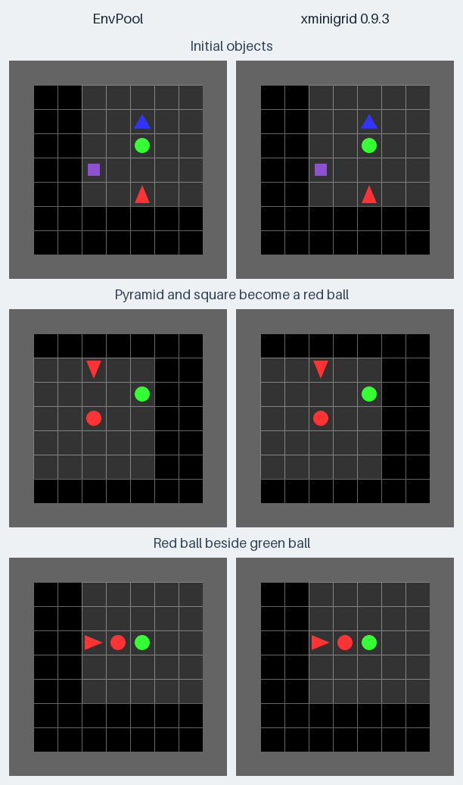

XLand-MiniGrid
==============

In XLand the agent learns a hidden goal and a set of rules by interacting
with objects. Several episodes can share the same rules while the map and
starting positions change. EnvPool implements all 44 registered environments
and their RGB renderer in C++ using the task definitions from
`xminigrid 0.9.3 <https://github.com/dunnolab/xland-minigrid/tree/0d306d1414dcb6e451358d94e7d9a91879462ee1>`_
(Apache 2.0).

Try a task
----------

An XLand ID chooses the room layout. **Supply a rule set to give the agent
a goal.** The upstream default is an empty task with zero reward.

In this example, putting the blue pyramid beside the purple square consumes
both and creates a red ball. To win, place the red ball beside the green
ball. The agent sees the objects and the effects of its actions. The goal
and rules stay hidden.

.. code-block:: python

    import numpy as np
    import envpool
    from envpool.xminigrid import RuleSet

    pyramid, square = (5, 3), (4, 4)
    red_ball, green_ball = (3, 1), (3, 2)
    task = RuleSet(
        goal=(4, *red_ball, *green_ball),
        rules=[(3, *pyramid, *square, *red_ball)],
        init_tiles=[pyramid, square, green_ball],
    )
    pool = envpool.make_gymnasium(
        "XLand-MiniGrid-R1-9x9", num_envs=2, seed=63,
        ruleset=task, render_mode="rgb_array",
    )
    obs, info = pool.reset()
    obs, reward, terminated, truncated, info = pool.step(
        np.array([0, 1], dtype=np.int32)
    )
    frames = pool.render(env_ids=[0, 1])

    # Give just slot 1 a new goal on its next reset.
    pickup = RuleSet(goal=(1, *green_ball, 0, 0), init_tiles=[green_ball])
    pool.set_ruleset(pickup, env_id=1)
    pool.reset(env_id=np.array([1], dtype=np.int32))
    pool.close()

Each slot keeps its task across resets. ``set_ruleset(task)`` stages a task
for all slots. Each switches on its next explicit or automatic reset.
``set_ruleset(RuleSet())`` restores the empty task.

The following episode shows the red triangle moving through the three
stages of the example. EnvPool is on the left and the official renderer
is on the right. The lighter cells are in the agent's field of view.

Available environments
----------------------

All 44 IDs use ``XMiniGrid/<upstream ID>``. The 21 XLand layouts also
accept their upstream names directly. Replace ``N`` with a listed size.

* ``XLand-MiniGrid-R1-NxN``, ``XLand-MiniGrid-R2-NxN`` and
  ``XLand-MiniGrid-R4-NxN`` use 9, 11, 13, 15 or 17.
* ``XLand-MiniGrid-R6-NxN`` uses 13, 17 or 19.
* ``XLand-MiniGrid-R9-NxN`` uses 16, 19 or 25.

The other 23 IDs select the built-in MiniGrid tasks from ``xminigrid``.
Their prefix distinguishes them from EnvPool's :doc:`minigrid` family.

* ``XMiniGrid/MiniGrid-Empty-NxN``, ``XMiniGrid/MiniGrid-EmptyRandom-NxN``
  and ``XMiniGrid/MiniGrid-DoorKey-NxN`` use 5, 6, 8 or 16.
* ``XMiniGrid/MiniGrid-MemorySN`` uses 8, 16, 32, 64 or 128.
* ``XMiniGrid/MiniGrid-FourRooms``, ``XMiniGrid/MiniGrid-LockedRoom``,
  ``XMiniGrid/MiniGrid-Playground``, ``XMiniGrid/MiniGrid-Unlock``,
  ``XMiniGrid/MiniGrid-UnlockPickUp`` and
  ``XMiniGrid/MiniGrid-BlockedUnlockPickUp`` have fixed sizes.

The empty rooms have a fixed start unless the ID includes ``EmptyRandom``.
Memory disables pickup and ends when the agent chooses a branch.
In ``BlockedUnlockPickUp`` the blocker can cover the key during generation,
as in version 0.9.3. Playground accepts ``num_objects`` (default 12).

Actions and observations
------------------------

The six actions are ``0`` forward, ``1`` turn right, ``2`` turn left,
``3`` pick up, ``4`` put down and ``5`` toggle a door. A locked door
requires a key of the same color.

The observation is a ``uint8`` array of shape
``(batch_size, view_size, view_size, 2)``. Each cell contains a tile type and
a color. The agent looks up from the bottom center of this view. Walls are
transparent to observation. ``view_size`` is an odd integer from 1 to 255.
It defaults to 5 for XLand, 3 for Memory and 7 for the other tasks.
``info["agent_pos"]`` gives the row and column in the full grid.
RGB frames show the full grid at 32 pixels per tile by default.

Success pays ``1 - 0.9 * elapsed_step / max_episode_steps``. All other
steps pay zero. The default XLand limit is three times the map area.
Success and a wrong turn in Memory terminate the episode. Reaching the
step limit sets ``truncated``, including when the final step also terminates.
The ``dm_env`` discount is zero on termination and one on timeout alone.

Encoded rules and goals
-----------------------

``RuleSet`` accepts integer sequences or ``uint8`` arrays. For a task
sampled from an upstream benchmark, pass its three fields as
``RuleSet(record.goal, record.rules, record.init_tiles)``. Benchmark data
is supplied separately. EnvPool runs these tasks without JAX.

* ``init_tiles`` has shape ``(objects, 2)``. Each reset samples the objects
  and the agent on distinct floor cells. ``(0, 0)`` is padding.
* ``rules`` has shape ``(rules, 7)``. A rule starts with an operation,
  followed by one or two input tiles and the output tile. Pad unused bytes
  with zeros. Rules run in order, so one product can trigger a later rule
  on the same step.
* ``goal`` has shape ``(5,)``. The first byte selects a condition. The
  remaining bytes encode tiles or a row and column, with zero padding.
  The goal is checked after all rules.

Rule 1 transforms a held tile, 2 transforms a tile near the agent and 3
combines two adjacent tiles. Rules 4–7 combine a directed pair and 8–11
transform a tile in a given direction from the agent. For a pair, the
direction locates the second tile relative to the first. Directions run
up, right, down and left in grid coordinates.

A pickup checks what the agent holds. A forward move checks what the
agent stands on or next to. A put-down checks directed agent adjacency
and tile pairs, even if the cell in front stays the same.

In version 0.9.3, a neighbor beyond the top or left edge wraps to the
opposite edge. Beyond the bottom or right edge, rules and goals see an
empty neighbor and writes outside the grid are discarded. Forward
movement stops at every edge, even if a rule removes an outer wall.

Goals 1–6 check holding a tile, standing on a tile, agent adjacency, tile
adjacency, a tile at a position and the agent at a position, respectively.
Goals 7–10 and 11–14 check directed tile and agent adjacency. Operation 0
disables a rule or goal. Tile and color codes are defined in the
`upstream constants <https://github.com/dunnolab/xland-minigrid/blob/0d306d1414dcb6e451358d94e7d9a91879462ee1/src/xminigrid/core/constants.py>`_.

Validation
----------

For each ID, tests transfer the initial grid and agent pose to the official
environment and derive any sampled goal or memory cue from the grid. Both
implementations then run independently to the end of the episode. The
tests also solve all eight tasks with a locked door, including moving
the blocker and putting down the key to pick up the target object. Native
tests separately check the sampled components across seeds, slots and
resets, including object locations, door colors and goals.

Discrete state and observations match exactly. Reward comparisons allow
``2e-7`` absolute error for single-precision arithmetic. For RGB frames the
mean absolute difference may reach one intensity level per channel within
each 32 by 32 tile. This allows differences at shape edges while keeping
a misplaced or missing object visible to the test.
